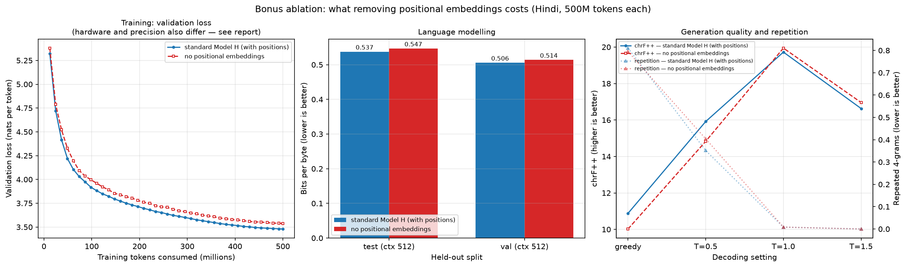
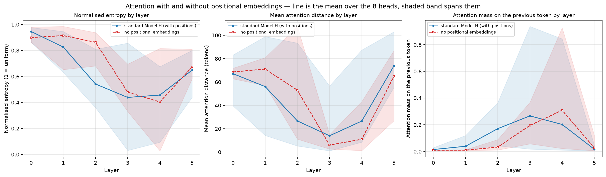

# Bonus ablation — a Hindi model trained with no positional embeddings

<!-- GENERATED by common/eval/write_nopos_report.py. Do not edit by hand; regenerate. -->

The optional ablation from the brief: retrain one model without positional embeddings, run the full Phase 2 evaluation suite on it, and compare against the standard model.

## 1. Setup

Hindi was chosen for the ablation: the shorter 512-token context makes it the faster run, and Model H is the stronger and cleaner baseline of the two.

|  | Model H (standard) | no positional embeddings |
|---|---:|---:|
| Positional embeddings | learned absolute, 512 × 512 | **none** |
| Parameters | 24,220,672 | 23,958,528 |
| Non-embedding parameters | 15,765,504 | 15,765,504 |
| Layers / width / heads | 6 / 512 / 8 | 6 / 512 / 8 |
| Context length | 512 | 512 |
| Training tokens | 500,023,296 | 500,023,296 |
| Tokens per optimizer step | 24,576 | 24,576 |
| Config fields that differ | use_positional_embeddings |  |

The only architectural difference is the position table, worth 262,144 parameters (512 × 512). Everything else — corpus, tokenizer, schedule, batch, seed — is identical.

**One difference that could not be held fixed:** Model H was pretrained on a Kaggle T4 in fp16, while the ablation ran on the local RTX 3050 in bf16. Precision and hardware therefore differ alongside the ablation, which is a limitation of the comparison.

## 2. Training

| progress | standard step | standard val loss | ablated step | ablated val loss | difference |
|---|---:|---:|---:|---:|---:|
| 25% of training | 5,000 | 3.8482 | 5,000 | 3.9211 | +0.073 |
| 50% of training | 10,000 | 3.6526 | 10,000 | 3.7116 | +0.059 |
| 75% of training | 15,000 | 3.5369 | 15,000 | 3.5948 | +0.058 |
| 100% of training | 20,346 | 3.4795 | 20,346 | 3.5378 | +0.058 |

Best validation loss during training: standard **3.4795**, ablated **3.5378**.

## 3. Perplexity and bits per byte

Same held-out text, identical token counts.

| split | context | PPL standard | PPL ablated | BPB standard | BPB ablated | BPB change |
|---|---:|---:|---:|---:|---:|---:|
| test | 512 | 35.59 | 37.83 | 0.5375 | 0.5467 | +1.7% |
| val | 512 | 32.88 | 34.82 | 0.5056 | 0.5139 | +1.6% |

## 4. Generation quality

200 prompts of 64 tokens from the validation split, continued for 128 tokens, scored against the true continuation.

### greedy

| metric | Model H (standard) | no positional embeddings | change |
|---|---:|---:|---:|
| BLEU | 1.46 | 1.08 | -25.8% |
| chrF++ | 10.88 | 10.02 | -7.9% |
| ROUGE-L | 0.089 | 0.085 | -4.2% |
| Distinct-1 | 0.056 | 0.054 | -3.8% |
| Distinct-2 | 0.122 | 0.117 | -3.9% |
| Repetition (4-gram) | 0.810 | 0.795 | -1.9% |

### T = 0.5

| metric | Model H (standard) | no positional embeddings | change |
|---|---:|---:|---:|
| BLEU | 1.78 | 1.58 | -11.0% |
| chrF++ | 15.92 | 14.83 | -6.8% |
| ROUGE-L | 0.115 | 0.111 | -3.7% |
| Distinct-1 | 0.120 | 0.115 | -4.0% |
| Distinct-2 | 0.381 | 0.351 | -8.1% |
| Repetition (4-gram) | 0.352 | 0.404 | +14.9% |

### T = 1.0

| metric | Model H (standard) | no positional embeddings | change |
|---|---:|---:|---:|
| BLEU | 1.24 | 1.19 | -4.2% |
| chrF++ | 19.72 | 19.94 | +1.1% |
| ROUGE-L | 0.107 | 0.110 | +2.6% |
| Distinct-1 | 0.317 | 0.310 | -2.3% |
| Distinct-2 | 0.824 | 0.819 | -0.6% |
| Repetition (4-gram) | 0.008 | 0.009 | +0.6% |

### T = 1.5

| metric | Model H (standard) | no positional embeddings | change |
|---|---:|---:|---:|
| BLEU | 0.19 | 0.21 | +10.0% |
| chrF++ | 16.63 | 16.96 | +2.0% |
| ROUGE-L | 0.054 | 0.058 | +6.5% |
| Distinct-1 | 0.550 | 0.536 | -2.7% |
| Distinct-2 | 0.988 | 0.984 | -0.4% |
| Repetition (4-gram) | 0.000 | 0.000 | -100.0% |

## 5. Attention

64 held-out windows of 256 tokens, seed 0 — the same windows Phase 2 used. Means over the 8 heads of each layer.

| layer | entropy std | entropy ablated | distance std | distance ablated | prev-token std | prev-token ablated |
|---|---:|---:|---:|---:|---:|---:|
| 0 | 0.946 | 0.900 | 67.2 | 68.6 | 0.015 | 0.009 |
| 1 | 0.826 | 0.915 | 56.1 | 71.1 | 0.039 | 0.010 |
| 2 | 0.542 | 0.863 | 26.7 | 53.0 | 0.171 | 0.033 |
| 3 | 0.439 | 0.479 | 14.0 | 6.1 | 0.267 | 0.195 |
| 4 | 0.457 | 0.404 | 26.6 | 11.0 | 0.202 | 0.309 |
| 5 | 0.648 | 0.673 | 73.8 | 65.0 | 0.017 | 0.027 |

Strongest previous-token head: standard **L3H7** at 0.937; ablated **L4H3** at 0.927. Heads with more than half their mass on the previous token: standard **2**, ablated **2**.

Heatmaps: `figures/attention_nopos_layer0.png`, `figures/attention_nopos_layer5.png` (compare with `figures/attention_hindi_layer0.png` and `attention_hindi_layer5.png`).

## 6. Figures

